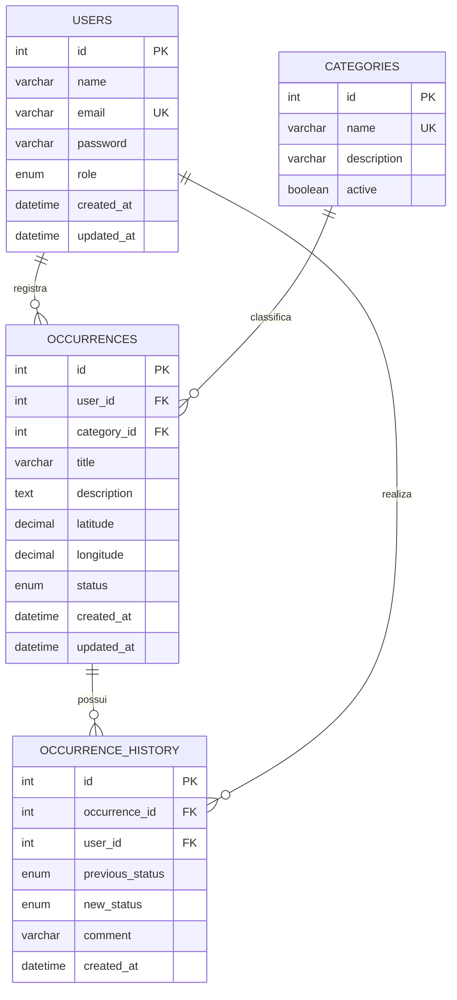

# CitySense — Modelo Entidade-Relacionamento (DER)

**Versão:** 1.0  
**Banco de dados:** MySQL

## 1. Objetivo

Este documento apresenta a modelagem inicial do banco de dados do CitySense, identificando suas entidades, atributos, chaves e relacionamentos.

O modelo busca garantir integridade, organização e consistência das informações armazenadas.

## 2. Entidades

### 2.1 Usuários — `users`

Armazena os dados dos usuários cadastrados na plataforma.

| Campo | Tipo | Restrição | Descrição |
|---|---|---|---|
| id | INT | PK, AUTO_INCREMENT | Identificador |
| name | VARCHAR(120) | NOT NULL | Nome |
| email | VARCHAR(150) | UNIQUE, NOT NULL | E-mail |
| password | VARCHAR(255) | NOT NULL | Hash da senha |
| role | ENUM | NOT NULL | citizen, organization ou admin |
| created_at | DATETIME | NOT NULL | Data de cadastro |
| updated_at | DATETIME | NULL | Última atualização |

### 2.2 Categorias — `categories`

Armazena as categorias disponíveis para classificar as ocorrências.

| Campo | Tipo | Restrição | Descrição |
|---|---|---|---|
| id | INT | PK, AUTO_INCREMENT | Identificador |
| name | VARCHAR(80) | UNIQUE, NOT NULL | Nome da categoria |
| description | VARCHAR(255) | NULL | Descrição |
| active | BOOLEAN | NOT NULL | Indica se está ativa |

Categorias iniciais sugeridas:
- Buraco em via pública.
- Iluminação pública.
- Calçada danificada.
- Descarte irregular de lixo.
- Sinalização danificada.
- Outros problemas de infraestrutura.

### 2.3 Ocorrências — `occurrences`

Armazena os problemas urbanos registrados pelos usuários.

| Campo | Tipo | Restrição | Descrição |
|---|---|---|---|
| id | INT | PK, AUTO_INCREMENT | Identificador |
| user_id | INT | FK, NOT NULL | Usuário responsável |
| category_id | INT | FK, NOT NULL | Categoria |
| title | VARCHAR(150) | NOT NULL | Título |
| description | TEXT | NOT NULL | Descrição |
| latitude | DECIMAL(10,7) | NOT NULL | Latitude |
| longitude | DECIMAL(10,7) | NOT NULL | Longitude |
| status | ENUM | NOT NULL | Estado atual |
| created_at | DATETIME | NOT NULL | Data de registro |
| updated_at | DATETIME | NULL | Última atualização |

Status iniciais:
- pending: pendente.
- in_analysis: em análise.
- resolved: resolvida.
- rejected: rejeitada.

### 2.4 Histórico de ocorrências — `occurrence_history`

Armazena as alterações de status realizadas nas ocorrências.

| Campo | Tipo | Restrição | Descrição |
|---|---|---|---|
| id | INT | PK, AUTO_INCREMENT | Identificador |
| occurrence_id | INT | FK, NOT NULL | Ocorrência relacionada |
| user_id | INT | FK, NOT NULL | Usuário responsável pela alteração |
| previous_status | ENUM | NULL | Status anterior |
| new_status | ENUM | NOT NULL | Novo status |
| comment | VARCHAR(500) | NULL | Observação da alteração |
| created_at | DATETIME | NOT NULL | Data da alteração |

## 3. Relacionamentos

- Um usuário poderá registrar várias ocorrências.
- Uma categoria poderá estar associada a várias ocorrências.
- Uma ocorrência poderá possuir várias alterações de status.
- Um usuário poderá realizar várias alterações de status.

## 4. Cardinalidade

| Relacionamento | Cardinalidade |
|---|---|
| users → occurrences | 1:N |
| categories → occurrences | 1:N |
| occurrences → occurrence_history | 1:N |
| users → occurrence_history | 1:N |

## 5. Diagrama conceitual

## 6. Regras de integridade

- Cada usuário deverá possuir um identificador único.
- O e-mail não poderá ser repetido.
- Cada ocorrência deverá estar associada a um usuário existente.
- Cada ocorrência deverá estar associada a uma categoria existente.
- O histórico deverá estar vinculado a uma ocorrência existente.
- As alterações de status deverão identificar o usuário responsável.
- As coordenadas deverão respeitar os limites geográficos válidos de latitude e longitude.
- As chaves estrangeiras deverão impedir referências a registros inexistentes.

## 7. Normalização

A modelagem separa usuários, categorias, ocorrências e histórico em tabelas distintas.

Essa divisão reduz a repetição de informações, facilita atualizações e permite manter relacionamentos consistentes por meio de chaves primárias e estrangeiras.

As categorias, por exemplo, são armazenadas separadamente, evitando repetir seus nomes em cada ocorrência.

## 8. Decisões e observações

- O campo `password` armazenará exclusivamente o hash da senha, nunca a senha em texto puro.
- O campo `role` diferencia cidadãos, organizações e administradores.
- A localização será armazenada por latitude e longitude.
- O status atual ficará na tabela `occurrences`, enquanto as alterações serão registradas em `occurrence_history`.
- O armazenamento de imagens poderá ser acrescentado posteriormente, caso o cronograma permita.
- A estrutura poderá receber ajustes durante a implementação, desde que sejam documentados.

## 9. Conclusão

O modelo inicial possui quatro entidades principais e relacionamentos que permitem implementar as funcionalidades centrais do CitySense. A estrutura atende à necessidade de armazenamento de usuários, categorias, ocorrências e acompanhamento de alterações.
