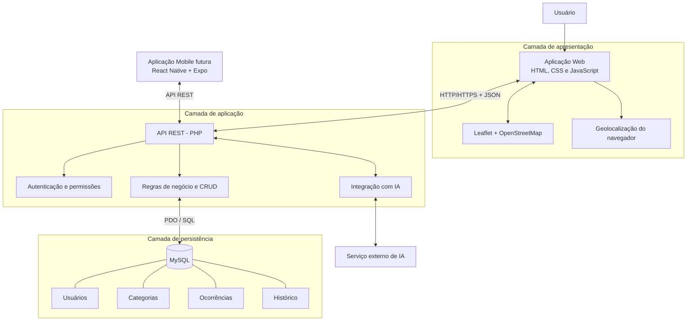

# Urbs — Arquitetura do Sistema

**Versão:** 1.1  
**Arquitetura:** Cliente-servidor com API REST  
**Backend:** PHP  
**Banco de dados:** MySQL

## 1. Visão geral

O Urbs utilizará uma arquitetura cliente-servidor organizada em três camadas principais: apresentação, aplicação e persistência de dados.

Essa estrutura permitirá separar a interface visual, as regras de negócio e o armazenamento das informações, facilitando a manutenção, os testes e a evolução do sistema.

A aplicação web será desenvolvida primeiro. Posteriormente, uma aplicação mobile poderá consumir a mesma API, sem necessidade de reconstruir o backend.

## 2. Componentes da arquitetura

### 2.1 Camada de apresentação — Frontend

Responsável pela interação com os usuários e pela exibição das informações.

**Tecnologias previstas:**
- HTML5: estrutura das páginas.
- CSS3: estilização e responsividade.
- JavaScript: interatividade e comunicação com a API.
- GSAP: animações e transições.
- Leaflet: exibição e interação com o mapa.
- OpenStreetMap: fornecimento dos dados cartográficos.

**Principais responsabilidades:**
- Apresentar as telas do sistema.
- Permitir cadastro e autenticação.
- Disponibilizar formulários de ocorrências.
- Obter coordenadas geográficas.
- Exibir ocorrências no mapa.
- Aplicar filtros e apresentar resultados.
- Exibir o assistente de inteligência artificial.

### 2.2 Camada de aplicação — Backend

Responsável pelo processamento das solicitações, execução das regras de negócio e comunicação com o banco de dados.

**Tecnologia prevista:** PHP.

O backend será organizado como uma API REST, utilizando requisições HTTP e respostas em formato JSON.

**Principais responsabilidades:**
- Autenticar usuários.
- Controlar permissões.
- Validar os dados recebidos.
- Realizar operações CRUD.
- Gerenciar ocorrências.
- Atualizar e consultar status.
- Registrar histórico de alterações.
- Intermediar a utilização do serviço de inteligência artificial.

### 2.3 Camada de persistência — Banco de dados

Responsável pelo armazenamento estruturado das informações.

**Tecnologia prevista:** MySQL.

**Dados principais:**
- Usuários.
- Categorias de ocorrências.
- Ocorrências urbanas.
- Histórico de alterações de status.

A comunicação com o banco será realizada pelo backend, utilizando consultas preparadas e relacionamentos por chaves estrangeiras.

## 3. Fluxo de comunicação

O funcionamento geral seguirá este fluxo:

1. O usuário interage com a aplicação web.
2. O frontend envia uma requisição HTTP para a API.
3. O backend recebe e valida os dados.
4. O backend executa as regras de negócio.
5. Quando necessário, realiza operações no banco de dados.
6. A API retorna uma resposta JSON.
7. O frontend interpreta a resposta e atualiza a interface.

## 4. Diagrama da arquitetura

O sistema será organizado em três camadas principais, com comunicação intermediada pela API REST. O frontend será responsável pela interface e interação com o usuário, enquanto o backend processará as requisições e realizará a comunicação com o banco de dados e serviços externos.

O diagrama representa a arquitetura planejada para o sistema. Alguns componentes, como a aplicação mobile e a integração com inteligência artificial, serão desenvolvidos posteriormente, conforme o cronograma do projeto.

## 5. Comunicação entre componentes

| Componente | Comunicação | Finalidade |
|---|---|---|
| Frontend e backend | HTTP/HTTPS e JSON | Envio e recebimento de dados |
| Backend e MySQL | PDO e SQL | Persistência de dados |
| Frontend e mapa | Leaflet e OpenStreetMap | Exibição e seleção de localizações |
| Frontend e navegador | API Geolocation | Obtenção da localização do dispositivo |
| Backend e serviço de IA | Requisições HTTP | Processamento de solicitações do assistente |
| Aplicação mobile e backend | API REST | Compartilhamento das funcionalidades |

## 6. Organização lógica da API

Os endpoints serão organizados por recursos.

| Método | Endpoint previsto | Finalidade |
|---|---|---|
| POST | /api/auth/register | Cadastro de usuário |
| POST | /api/auth/login | Autenticação |
| GET | /api/occurrences | Listagem de ocorrências |
| GET | /api/occurrences/{id} | Detalhes de uma ocorrência |
| POST | /api/occurrences | Cadastro de ocorrência |
| PUT | /api/occurrences/{id} | Atualização de ocorrência autorizada |
| DELETE | /api/occurrences/{id} | Exclusão de ocorrência autorizada, respeitando a integridade do histórico |
| PATCH | /api/occurrences/{id}/status | Atualização de status por administrador |
| GET | /api/occurrences/{id}/history | Consulta do histórico |
| GET | /api/categories | Listagem de categorias |
| POST | /api/assistant | Envio de solicitação ao assistente |

Os endpoints são uma proposta inicial e poderão ser ajustados durante a implementação.

## 7. Segurança

A arquitetura deverá considerar:

- Armazenamento de senhas com `password_hash()` e verificação com `password_verify()`.
- Consultas preparadas por meio de PDO.
- Validação dos dados no backend.
- Controle de acesso por perfil.
- Proteção de rotas administrativas.
- Gerenciamento seguro de sessões ou mecanismo de autenticação definido na implementação.
- Proteção de credenciais e chaves de serviços externos.
- Comunicação HTTPS no ambiente publicado.

## 8. Arquitetura do assistente de IA

O assistente será integrado ao backend para evitar a exposição de chaves de acesso no frontend.

**Fluxo previsto:**

1. O usuário envia uma mensagem pela interface.
2. O frontend encaminha a mensagem para a API.
3. O backend valida a solicitação.
4. O backend consulta o serviço de inteligência artificial.
5. A resposta é processada e devolvida ao frontend.

O assistente terá como finalidade orientar o uso da plataforma e auxiliar na elaboração e categorização das descrições das ocorrências.

Não deverá afirmar que uma ocorrência foi oficialmente encaminhada ou solucionada.

## 9. Aplicação mobile futura

A aplicação mobile será planejada utilizando React Native e Expo.

Ela consumirá a mesma API REST da aplicação web, compartilhando:
- Autenticação.
- Usuários.
- Ocorrências.
- Categorias.
- Histórico.
- Recursos do assistente.

A implementação mobile será priorizada após a consolidação da versão web, respeitando o cronograma do TCC.

## 10. Considerações finais

A arquitetura proposta busca manter o Urbs modular, organizado e preparado para evolução. A separação entre frontend, backend e banco de dados permite que diferentes interfaces utilizem os mesmos serviços e regras de negócio.

Essa organização também facilita a manutenção, a realização de testes e a implementação de novas funcionalidades, mantendo a estrutura preparada para futuras expansões.
