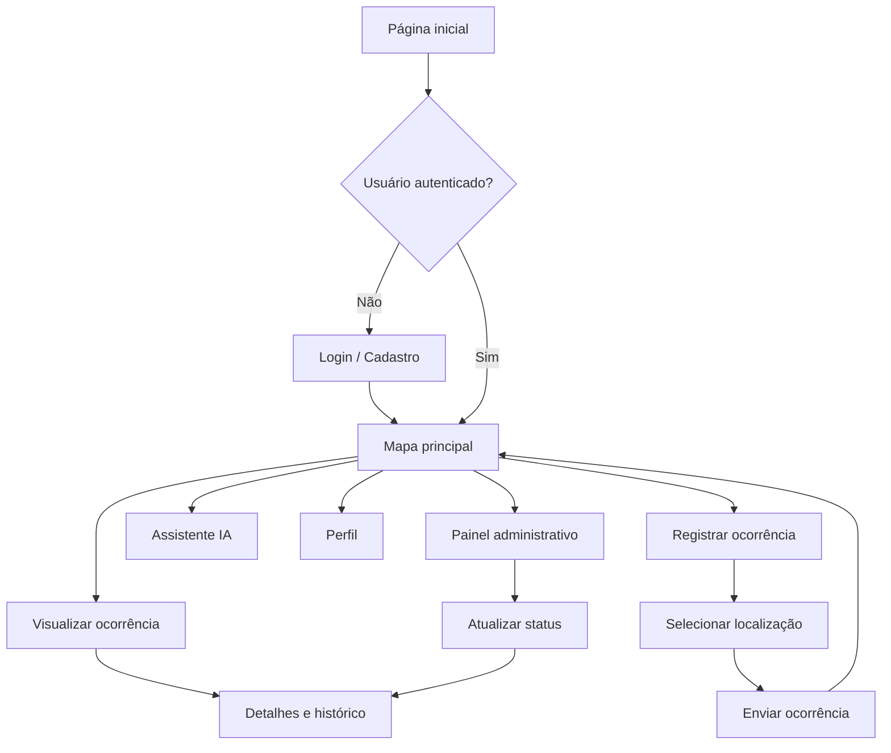

# CitySense — Planejamento dos Protótipos de Interface

**Versão:** 1.0

## 1. Objetivo

Este documento descreve as principais telas da aplicação web CitySense, servindo como referência para a criação dos protótipos e posterior desenvolvimento da interface.

A identidade visual deverá transmitir tecnologia, confiança, organização e acessibilidade.

## 2. Diretrizes visuais

- Interface moderna e responsiva.
- Navegação simples e intuitiva.
- Hierarquia visual clara.
- Uso consistente de cores, tipografia e componentes.
- Mapa como elemento central da experiência.
- Animações discretas, sem prejudicar a usabilidade.
- Compatibilidade com computadores e dispositivos móveis.

## 3. Telas planejadas

### Tela 01 — Página inicial

**Objetivo:** apresentar o CitySense e explicar sua finalidade.

Elementos:
- Logotipo e nome do sistema.
- Menu de navegação.
- Texto de apresentação.
- Botão para acessar o mapa.
- Botão para entrar ou cadastrar-se.
- Seção explicando como funciona a plataforma.
- Indicadores gerais de ocorrências, caso existam dados reais cadastrados no sistema.

### Tela 02 — Cadastro e login

**Objetivo:** permitir acesso à plataforma.

Elementos:
- Campo de e-mail.
- Campo de senha.
- Formulário de cadastro.
- Validação dos campos.
- Mensagens de sucesso e erro.
- Navegação entre login e cadastro.

### Tela 03 — Painel principal / Mapa

**Objetivo:** permitir a visualização das ocorrências urbanas.

Elementos:
- Mapa interativo.
- Marcadores representando ocorrências.
- Legenda de categorias e status.
- Campo de pesquisa.
- Filtros por categoria e status.
- Botão para obter localização atual.
- Botão para registrar ocorrência.
- Área de detalhes da ocorrência selecionada.

### Tela 04 — Cadastro de ocorrência

**Objetivo:** permitir que usuários registrem problemas de infraestrutura urbana.

Elementos:
- Campo de título.
- Campo de descrição.
- Seleção de categoria.
- Mapa para escolha da localização.
- Botão para utilizar localização atual.
- Exibição de latitude e longitude.
- Botão para enviar o registro.
- Mensagens de validação.

### Tela 05 — Detalhes da ocorrência

**Objetivo:** apresentar as informações de um registro específico.

Elementos:
- Título e descrição.
- Categoria.
- Localização no mapa.
- Data de registro.
- Usuário responsável, respeitando as regras de privacidade.
- Status atual.
- Histórico de alterações.

### Tela 06 — Painel administrativo

**Objetivo:** permitir o gerenciamento das ocorrências.

Elementos:
- Lista de ocorrências.
- Filtros.
- Visualização dos detalhes.
- Opções de moderação.
- Controle de atualização de status.
- Campo de observação para registrar alterações.

### Tela 07 — Assistente de inteligência artificial

**Objetivo:** auxiliar os usuários na utilização da plataforma.

Elementos:
- Área de conversa.
- Campo para digitar mensagens.
- Botão de envio.
- Mensagens do usuário e do assistente.
- Sugestões de utilização.
- Orientação para melhorar a descrição de ocorrências.

O assistente não deverá substituir os formulários oficiais do sistema nem afirmar que registros foram enviados a órgãos públicos.

### Tela 08 — Perfil do usuário

**Objetivo:** apresentar informações e atividades do usuário.

Elementos:
- Nome e e-mail.
- Tipo de usuário.
- Lista de ocorrências registradas.
- Status das ocorrências.
- Opção de sair da conta.

## 4. Fluxo de navegação

## 5. Ordem de desenvolvimento das telas

1. Login e cadastro.
2. Mapa principal.
3. Cadastro de ocorrência.
4. Detalhes da ocorrência.
5. Painel administrativo.
6. Perfil do usuário.
7. Assistente de inteligência artificial.
8. Página inicial institucional.

A ordem poderá ser ajustada conforme as dependências técnicas e o cronograma.

## 6. Responsividade

Os protótipos deverão considerar pelo menos duas versões:

- Desktop: navegação com menu lateral ou superior e mapa com painel de informações.
- Mobile: navegação adaptada, formulários em coluna e mapa ocupando a área disponível.

## 7. Critérios de avaliação dos protótipos

- Clareza da navegação.
- Facilidade de utilização.
- Consistência visual.
- Adequação ao público-alvo.
- Responsividade.
- Coerência com os requisitos funcionais.

## 8. Conclusão

Os protótipos orientarão a construção da interface do CitySense, permitindo avaliar a organização das informações e o fluxo de navegação antes da implementação definitiva.
